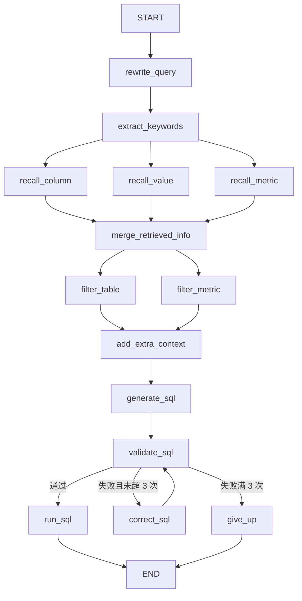

# NL2SQL — 电商问数 Agent

用自然语言直接查数仓。输入「统计华北地区的销售总额」，Agent 自己完成
**关键词抽取 → 字段/取值/指标三路召回 → 候选表与指标过滤 → 生成 SQL → EXPLAIN 校验与自动修正 → 执行 → 返回表格** 的完整链路。

后端 FastAPI + LangGraph，前端 React + Vite，向量检索用 Qdrant，字段取值检索用 Elasticsearch。

## 核心设计

- **多轮追问改写**：前端每轮请求携带最近 3 轮会话历史，入口的 `rewrite_query` 节点把「那上个月呢」补全成独立完整的问题；后端自身不保存会话，天然无状态。
- **三路并行召回**：字段和指标走 Qdrant 向量检索，字段取值走 ES 全文检索（含 IK 分词），三路召回在 `merge_retrieved_info` 汇合。
- **生成 → 校验 → 修正闭环**：SQL 生成后先用 `EXPLAIN` 校验，失败交给 `correct_sql` 修正，修正完再回到校验，最多 3 轮；连续失败走 `give_up` 节点向用户输出「暂不支持」，而不是抛异常堆栈。
- **执行过程可观测**：每个节点通过 `runtime.stream_writer` 推进度，前端 `StepRail` 实时展示当前走到哪一步。



## 目录结构

```
main.py                    FastAPI 入口，注册路由与 request_id 中间件
app/agent/                 LangGraph 编排：graph.py 组装图，nodes/ 下每个节点一步
app/api/                   路由、请求响应 schema、lifespan 资源初始化
app/clients/               MySQL / Qdrant / ES / Embedding 客户端管理
app/repositories/          按数据源分包：mysql(meta/dw) / qdrant / es
app/services/              元数据知识库构建、问数业务编排
app/scripts/               build_meta_knowledge.py 构建元数据知识库的 CLI 入口
app/entities/ app/models/  领域实体与 ORM 模型
conf/                      运行时配置（连接信息、模型名等）
docker/                    MySQL 初始化 SQL、ES + IK 镜像、compose 编排
prompts/                   各节点的 Prompt 模板
frontend/                  React + Vite 聊天式问数界面
```

## 依赖服务

`docker/docker-compose.yaml` 一次拉起全套：

| 服务 | 端口 | 用途 |
| --- | --- | --- |
| MySQL | 3307 | `meta` 元数据库 + `dw` 数仓（避开本机 3306） |
| Elasticsearch 8.19（含 IK 分词） | 9200 | 字段取值全文检索 |
| Kibana | 5601 | ES 可视化调试 |
| Qdrant v1.16 | 6333 / 6334 | 字段与指标向量库 |
| TEI embedding | 8081 | `BAAI/bge-large-zh-v1.5` 向量化服务 |

## 快速开始

1. 拉起依赖服务

   ```bash
   docker compose -f docker/docker-compose.yaml up -d
   ```

   embedding 服务挂载 `docker/embedding/bge-large-zh-v1.5`，模型权重体积较大**不入库**，
   需自行下载后放到该目录。

2. 配置密钥

   ```bash
   cp .env.example .env    # 填入 LLM_API_KEY
   ```

   `conf/app_config.yaml` 里的 `llm.api_key` 通过 `${oc.env:LLM_API_KEY}` 从环境变量读取，
   真实密钥只存在 `.env`（已被 `.gitignore` 忽略）。

3. 构建元数据知识库（把 meta 库的字段/指标写入 Qdrant，取值写入 ES）

   ```bash
   python -m app.scripts.build_meta_knowledge -c conf/meta_config.yaml
   ```

4. 启动后端

   ```bash
   uvicorn main:app --reload --port 8000
   ```

   接口文档见 `http://127.0.0.1:8000/docs`。

5. 启动前端

   ```bash
   cd frontend
   pnpm install
   pnpm dev
   ```

   前端默认通过 Vite 代理把请求转发到 `http://127.0.0.1:8000`，可用
   `frontend/.env` 里的 `VITE_DEV_PROXY_TARGET` 覆盖。

## 技术栈

`FastAPI` · `LangGraph` · `SQLAlchemy(async)` · `Qdrant` · `Elasticsearch` · `MySQL 8` ·
`Text Embeddings Inference` · `React 19` · `Vite` · `TailwindCSS`
